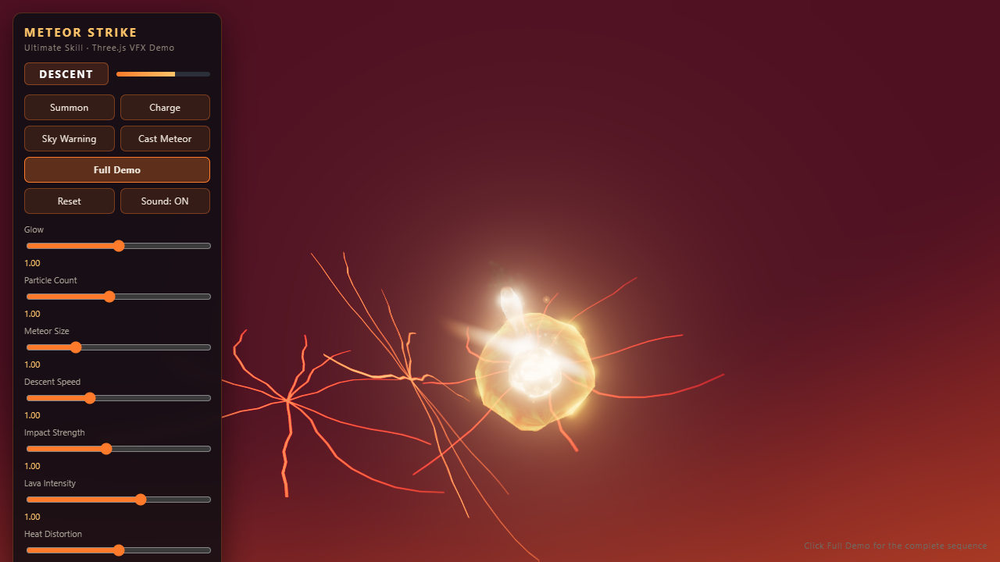

# METEOR STRIKE — Three.js Ultimate-Skill VFX Demo

A cinematic ultimate-ability sequence driven by an 8-state machine: ground magic circle
summon → charge → sky warning → meteor descent → impact → crater / lava aftermath field →
dissipate. **Every texture and every sound is generated procedurally at runtime — there are
no external asset files in this repo.**



## Run it

```bash
npm install
npm run serve
# then open  http://127.0.0.1:8792/index.html  in your browser
```

> **Do not double-click `index.html`.** Opening it as a `file://` path will show a blank page:
> the demo uses an ES-module import map that resolves `three` from `node_modules`, and browsers
> block that over `file://`. You must run it through the included server (`npm run serve`) or any
> other static HTTP server.

Requirements:

| | Minimum |
|---|---|
| Node.js | 18 or newer (declared in `package.json` → `engines`) |
| Browser | Chrome / Edge 89+, Firefox 108+, or Safari 16.4+ (import-map support) |
| GPU | WebGL2. Integrated laptop GPUs work; the render scale is adjustable via the sliders. |
| Network | Only for the one-time `npm install` (fetches `three`). After that the demo runs offline. |

Click **Full Demo** to play the whole sequence. The individual phase buttons
(`Summon`, `Charge`, `Sky Warning`, `Cast Meteor`) jump to a single phase, and **Reset** returns to
IDLE. Audio starts on your first click — browsers require a user gesture before sound can play,
so the **Sound: ON/OFF** button is the master switch.

If port 8792 is already taken, the server walks up to the next free port and prints the real URL:

```
[SERVE] port 8792 is busy, trying 8793 ...
[SERVE] http://127.0.0.1:8793/index.html
```

Force a specific port with `PORT=9000 npm run serve` (Windows PowerShell:
`$env:PORT=9000; npm run serve`).

## File structure

```
index.html
package.json
src/
  main.js                  renderer/scene/loop assembly, exposes window.__meteorApp
  params.js                runtime parameters wired to the sliders
  stateMachine.js          IDLE..DISSIPATE state machine
  cameraDirector.js        per-phase camera poses + descent tracking + shake layer
  director.js              choreography that wires the state machine to every effect/audio layer
  ui.js                    buttons / sliders / phase readout
  audio/
    meteorAudio.js         6 procedural Web Audio layers + one-shot impact events
  effects/
    glslCommon.js          shared GLSL fbm/hash chunks
    proceduralTextures.js  (src/assets) procedural canvas textures + seam avoidance
    magicCircle.js         5 counter-rotating rings + core + rune arcs
    meteor.js              rock crust + lava cracks + fire aura + core + breakup
    fireTrail.js           descent ribbon trail + motion streak
    explosion.js           fireball, flame plume, ground flash, 3D debris (instanced)
    shockwave.js           3 shockwave rings + thermal skirt + dust sheet
    crater.js              terrain-deformed crater + terrain-following decals (scorch / lava cracks)
    lava.js                lava pool + rim glow + ember loop + smoke
    particles.js           5 pooled GPU particle systems
    postfx.js              RenderPass → UnrealBloom → HeatDistortion → OutputPass
    cameraShake.js         base + impulse camera shake
    skyWarning.js          sky fracture + approaching light source
    environment.js         sky dome, lighting, fog, rocks, ground haze
  assets/
    proceduralTextures.js
    LICENSES.md
  quality/
    renderQualityGate.js   in-browser render quality measurements (A1..F1)
tools/
  serve.mjs                dependency-free static server + gate report receiver
  quality/gate.mjs         gate runner (static checks + per-phase table)
  quality/summarize.mjs    report aggregation
  quality/wait-report.mjs  report waiter
```

## State machine

| State | Purpose | Main visuals | Audio |
|---|---|---|---|
| IDLE | standby | dark haze only | silence |
| SUMMON | foreshadowing | magic circle scale-up / fade-in, 5 counter-rotating layers | bed rumble + hum |
| CHARGE | build-up | rising brightness/rotation, particle suction, heat distortion | rising hum/shimmer |
| SKY_WARNING | pressure | sky fracture, dome turning red, distant approaching light | low-frequency warning |
| DESCENT | fall | meteor + fire tail + smoke + debris, camera tracking | whoosh/roar |
| IMPACT | collision | flash/fireball/plume/shockwave/debris/dust, strong shake | crack + thud + crash |
| AFTERMATH | lingering | crater, lava cracks, ember/smoke loops, heat distortion | magma ambience |
| DISSIPATE | fade-out | everything attenuates | fade-out |

## Performance notes

- Particles reuse fixed-capacity buffers with dead-particle compaction (shrinking `drawRange`).
- The descent ribbon updates a fixed-size buffer every frame (no allocation).
- Debris uses a pool of 140 `InstancedMesh` instances.
- Textures are built once at load; anisotropy is unified to the hardware maximum.
- `dispose()` in each module frees the geometry/materials it owns.

## Verification

```bash
npm run gate:static   # static source checks (no GPU needed)
npm run gate          # runtime measurement across all 8 phases
```

`npm run gate` drives a browser automatically **if** the `playwright` node module is present.
Playwright is deliberately **not** in `dependencies`/`devDependencies`, because installing it
downloads browser binaries (hundreds of MB) that a viewer of the demo does not need. To enable the
automated gate, run:

```bash
npm run gate:setup    # npm i -D playwright && npx playwright install chromium
```

Without Playwright the runner prints the 8 URLs you need to open yourself and then waits for
`quality/report-<PHASE>.json` to arrive.

Measured checks: A1 repeating-texture seams / B1 NaN·Inf in the HDR buffer / C1 MSAA samples /
C2 composer chain / C3 grain delta / C4 bloom flicker and dark patches / C5 anisotropy /
D1 decal clearance / E1 frame regression + black squares / F1 console errors.
Anything not measured is reported as `NOT TESTED`, never as `PASS`.

### Measurement results 2026-10-11 (1280x720, Chromium)

8 static checks PASS. Runtime across 8 phases: **PASS 99 / WARN 0 / FAIL 0 / NOT TESTED 13**
(NOT TESTED = D1 in the 5 phases where no crater exists yet, and C3 because this project has no
film-grain pass).

| Phase | Mean luma | Drift | Flicker | Black squares | NaN/Inf | HDR max | Console errors | D1 clearance |
|---|---|---|---|---|---|---|---|---|
| IDLE | 17.9 | 0.4% | 0 | 0 | 0 | 1.0 | 0 | – |
| SUMMON | 29.1 | 0.4% | 0 | 0 | 0 | 2.2 | 0 | – |
| CHARGE | 114.1 | 0.1% | 0 | 0 | 0 | 9.2 | 0 | – |
| SKY_WARNING | 51.9 | 0.8% | 0 | 0 | 0 | 1.7 | 0 | – |
| DESCENT | 45.1 | 0.1% | 0 | 0 | 0 | 3.0 | 0 | – |
| IMPACT | 205.3 | 0.3% | 0 | 0 | 0 | 50.1 | 0 | 0.386 |
| AFTERMATH | 40.9 | 9.8% | 0 | 0 | 0 | 2.9 | 0 | 0.291 |
| DISSIPATE | 25.8 | 8.1% | 0 | 0 | 0 | 1.8 | 0 | 0.336 |

C1 `samples=4 / HalfFloat`, C2 `RenderPass→UnrealBloom→HeatDistortion→OutputPass`,
C4 bloom flicker 0, C5 anisotropy 16/16, all 5 repeating textures PASS A1.

Camera director (22 samples during DESCENT): the meteor stays inside the frame for the entire
descent (0 out-of-frame samples), crossing the screen from NDC y +0.33 → −0.38, angular size
1.3° → 11.7°, FOV 58 → 62.

Impact clipping profile (time since impact): 0.05s pure white 13% → 0.2s 15% → 0.9s 11% →
1.3s 0% → 1.8s 0%. No interval where the whole screen burns out.

Aftermath field screen coverage (AFTERMATH at 3s, pixel classification
`r>70 && r>g*1.5 && g>=b`): warm glowing area covers 16.8% of the full frame, 12.0% of the lower
half only. The lava pool (radius 17.2) is visible at NDC (0, −0.28), crack decal opacity 0.70,
scorch 0.81, 130 remaining rubble stones, 364 embers / 277 smoke particles.

Audio (limiter output measured through an AnalyserNode, 48 kHz):

| Segment | Peak | Mean RMS | Clipped frames |
|---|---|---|---|
| SKY_WARNING | 0.37 | 0.112 | 0 |
| DESCENT | 0.66 | 0.145 | 0 |
| IMPACT (2.5s window) | 0.87 | 0.138 | 0 |
| AFTERMATH (6s window) | 0.61 | 0.148 | 0 |
| IDLE | 0.20 | 0.006 | 0 |

Lifecycle measurement (deterministic stepping): crater radius 21 · depth 8.2 · rim +3.84, the lava
pool follows the floor and holds a 0.25 gap, the ground starts refilling at DISSIPATE 1.6s and
reaches a minimum of 0 at 5.0s (flat circular floor).

Behaviour: after a full **Full Demo** run the state machine returns to IDLE; `Reset` leaves 0
particles, 0 crater and lava disabled; `Sound OFF` sets master gain 0 and `ON` sets 0.8; on window
resize the renderer, composer and particle projection scales are all recomputed.

Lifecycle measurement (deterministic stepping): ground minimum at IMPACT is −9.09 (crater depth 8.2
plus surface relief), the residual field is maintained through AFTERMATH 3s, the ground refills from
DISSIPATE 1.6s and reaches minimum 0 at 5.0s (flat circular floor), and scorch/crack decals plus lava
all disappear → IDLE returns to a clean floor.

## Second round: user-observed defects and measurements

Reported as "the fall is good, but after the impact there is no crater, just weird orange lines".
That report exposed the following defects:

| Defect | Measured | Cause | Fix |
|---|---|---|---|
| No lava on the crater floor | pool Y `0.25` vs floor `−6.52` → **gap of 6.77** | `activate()` conformed once at `crater.progress === 0`. When the terrain was later carved out, the pool did not follow | `Lava.update` now watches `crater.progress` and re-conforms each change → gap 0.25 |
| "Orange line" | a flat disc of radius 15.6 floating at y=0.25, observed almost edge-on by a camera at y=4.4 | consequence of the item above: the plane reads as a line when seen edge-on | lava follows the bowl + camera raised |
| Crater not visible | camera horizontal distance 19.6 vs crater radius 19, camera height 4.4 vs rim 2.1 | the camera sat on the rim looking tangentially | AFTERMATH pose `[16.5, 12.0, 23.0]` → look-at `[0, −2.8, 0]`, rim spans NDC x −1.03..1.04 |
| Gravel not visible | 140 debris pieces sized 0.28–1.0, unlit after the lighting decayed | they depended only on the explosion light (dies at 1.9s) | 130 persistent rubble stones added to the crater (`InstancedMesh`, 0.59–1.61) with emissive that reacts to the lava light |
| Impact sounded weak | pre-limiter peak 1.008 (DESCENT) · 0.996 (IMPACT), 20–80 Hz band saturated | the sub-bass (24–38 Hz) consumed all headroom — silent on laptop speakers while the limiter was working | 30 Hz highpass tilt, sub gain 0.22→0.10 and other rebalancing, audible mid punch 300→58 Hz, tanh waveshaper, limiter threshold −10→−3 / ratio 14→4 |
| No lava gurgle or crushing | crackle peak 0.10, bubbling 0.10, period 220–1320 ms | not enough energy in the audible band | gurgle 110–320 Hz (frequency-varying) + fumarole hiss added, crackle peak 0.26, period 130–830 ms, rock-tumble/blorp event branches |

This round also caught a new regression in the gate: increasing the relief created a **slope
discontinuity** at the rim, collapsing decal clearance from 0.3 → 0.066 (D1 FAIL). `heightAt` was
rewritten as a smoothstep-blended C1-continuous profile, the decal ring went 28→60 and clearance
0.3→0.42, recovering D1 to 0.291–0.386.

## Third round: the flame plume and the feel of the impact

| Problem (user report) | Measurement | Cause | Fix |
|---|---|---|---|
| "What is that vertical orange column? It isn't even smoke" | the column covered 15.5% of the frame, mean pixel contribution 14.9 / max 33, hard-edged pixels 0 | uniform alpha over a cylinder silhouette → a glowing bar and a pale veil. Turbulence acted only radially, so the outline stayed intact | plume profile (wide base · pinched neck · billowing head), turbulence displacement growing with height, narrow shape window (0.36–0.60) for flame tongues + real gaps, top decays into ash, height 38→26 · radius 6→4.8 |
| | re-measured: frame coverage **0.9% → 4.0%**, vertical extent grew 50→222 rows, **sd/mean 0.84–1.06** | sd/mean ≪ 1 means a uniform bar; near 1 means strong internal structure | confirmed |
| "The impact goes *boing* and stops" | not a spectrum problem but a waveform problem: **oscillator sweeps** 110→24 Hz, 60→18 Hz, 300→58 Hz were the main components of the impact | swept sine/triangle waves make a cartoon boom, and no material sound follows them | all replaced with noise transients: broad slam (2600→700 Hz bandpass, 2 ms attack), low-frequency body "thud" (brown noise, lowpass 420→130), three slab-fracture snaps, tanh-distorted fireball roar, ground roll. The sub layer only adds weight at 70→28 Hz, 0.24 |
| "I should hear gravel hitting the ground" | 0 sustained events after impact (only 14 one-shot bursts, all within 3.2 s) | no scheduler existed | `_startDebrisRain()` — over 5.5 s, 110–300 ms intervals, 7→2 hits per burst, split between large rocks (120–340 Hz low band) and small gravel (300–2500 Hz), intensity decaying over time |
| | measured: **38 transient onsets** in a 6 s window, mean ZCR 2324 Hz (minimum 820) | a swept sine must have monotonically falling ZCR. Fluctuating 820–3469 Hz = broadband material transients | confirmed |
| Levels | bus 0.85 → peak 1.04 + 1 clipped frame | headroom exceeded | bus 0.72 → **peak 0.885, clipping 0** |

One measurement-methodology error was found too: the isolation probe called `readPixels(HALF_FLOAT)`
**after** `setRenderTarget(null)`, which ANGLE rejected with "Invalid format and type combination" →
the plume contribution was wrongly measured as 0. Reading while the render target was still bound
gave the real value.

Other layers are ducked within 0.15 s at impact (bed 0.14 / warning 0.08 / descent 0.12) so the
impact is not buried in the ambience.

Final gate: **PASS 99 / FAIL 0 / WARN 0 / NOT TESTED 13**, 0 console errors, 0 NaN/Inf,
0 bloom dark patches, D1 0.291–0.386.

## Fourth round: the lava was not rendering at all (user report → measurement)

Reported as "after the impact there is no crater and no lava, only orange vertical/horizontal
lines". Two real defects were confirmed.

### Defect 1 — uniform scaling also multiplied Y, burying the decals and lava underground

`scorch.scale.setScalar(50.4)` while `_conformDecal` used the **world terrain height** as the local Y.
An Object3D matrix is T·R·S, so world Y = local Y × 50.4:

| Object | Intended world Y | Actual world Y |
|---|---|---|
| scorch / fissure decals | −8.67 | **−436** |
| lava pool | −8.65 | **−151** |

→ changed to `scale.set(r, 1, r)`. Re-measured: decals −8.48..+4.34, pool −8.65..−2.69 (floor −8.9) — correct.

### Defect 2 — the terrain-following discs were wound facing away and got culled

Per-object contribution measured with an isolated HDR probe showed the lava pool at **0 pixels**
(its height and intensity were fine). Same scene, changing only `side`:

| side | frame contribution |
|---|---|
| FrontSide | **0.0000** |
| DoubleSide | **0.2456**, max contribution 1225 |
| BackSide | 0.2456 |

Repositioning vertices to follow a concave bowl flips the winding on the walls, so the three
following discs (lava pool · scorch · cracks) were switched to `DoubleSide`.

Aftermath contributions after the fix (640×400 HDR probe, before tone mapping):

| Object | Frame coverage | Mean contribution | Max |
|---|---|---|---|
| lava pool | 23.9% (was 0%) | 390 | 832 |
| crack decals | 9.9% (was 0.3%) | 127 | 409 |
| scorch | 23.5% | 12 | 283 |
| lava rim | 0.8% | 203 | 205 |
| remaining rubble | 14.0% | 23 | 2112 |

### Defect 3 — gate D1 was comparing local Y against world ground

The gate did not catch defect 1. `pos[i+1] - groundY(...)` omitted `scale.y`. After fixing it to
`pos[i+1] * mesh.scale.y + mesh.position.y` and adding the lava pool to the checked set, **0.127
(FAIL)** appeared immediately — the pool was placed at the analytic height while the actual ground
mesh is interpolated at 1.33 spacing and can sit up to 0.17 higher on steep walls, so the pool
punched through the crater wall.

Fix: `LAVA_CLEARANCE` 0.3→0.5, pool radius `radius*0.82`→`*0.68` (kept inside the flat floor), pool
vertex displacement 0.12→0.06. Re-measured D1 0.291–0.386, and the worst surface moved from
`lavaPool` to `scorch`.

### The remaining vertical line

The column measured as a tall narrow structure occupying **68% of a single screen column** → height
26→16, radius 4.8→8, lifetime 1.45→1.15 s, turning it from a "tower" into a "squat plume".
Re-measured: maximum column occupancy 0.86 → 0.46 (at impact +0.3 s); in AFTERMATH the maximum
column is 0.37 and the maximum row is 1.0, i.e. a wide glowing band (the intended lava + horizon-lit
red sky), not a thin line.

Final gate: **PASS 99 / FAIL 0 / WARN 0 / NOT TESTED 13**, 0 console errors, 0 flicker,
0 black squares, 0 NaN/Inf, D1 0.291–0.386.

## Fifth round: "octopus tentacles everywhere" and "two leftover lines"

| Symptom | Cause (measured) | Fix |
|---|---|---|
| Orange lines radiating in every direction (octopus tentacles) | the crack decal texture was built as **14 radial polylines from the centre** — the tentacle pattern itself | regenerated from 52 seeds into a **crack network** where each seed links to its 2–4 nearest neighbours (jittered polylines, wide near the centre, thinning outward) |
| | verification: radial coverage sampled over 72 angle bins — **0 complete spokes**, highest 0.33/41, mean 0.14 | spoke structure gone |
| Two lines remaining after the lava went out | a separate `TorusGeometry` rim mesh. At shallow angles it reads as two arcs, near and far, and it survived at `intensity > 0.15` after the pool shader faded | rim mesh **deleted**, replaced by a `rimBand` (rr 0.70–0.90) inside the pool fragment shader — geometry that cannot become a line at any angle |
| The rim band was too bright (AFTERMATH 54.6 → 101.8) | band width 0.52–1.00, intensity 1.1 | 0.70–0.90, intensity 0.55 → AFTERMATH 55.2 |

Final gate: **PASS 99 / FAIL 0 / WARN 0 / NOT TESTED 13**, 0 console errors, 0 flicker,
0 black squares, 0 NaN/Inf, 0 A1 failures, D1 0.291–0.386 (worst surface `scorch`, not the lava pool).

## Known limitations / improvement ideas

- The circle runes are canvas-drawn, so the strokes soften under strong zoom. A signed-distance-field
  rune atlas would be the right approach for a shipping game.
- Heat distortion is a screen-space displacement (a fake refraction). Precise thermal distortion would
  need two render targets plus normal-map sampling.
- Particle CPU updates are O(n) in capacity. Pushing past ~20,000 particles should move the simulation
  to the GPU.
- Audio uses procedural synthesis only. A real project would gain immersion from a per-layer reverb send
  and position-based `PannerNode` 3D panning for each impact location.

## License

MIT — see [LICENSE](LICENSE). The demo bundles no third-party media; the only third-party library is
`three` (MIT). Details in [assets/LICENSES.md](assets/LICENSES.md).
